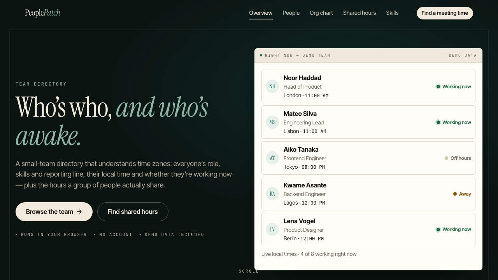
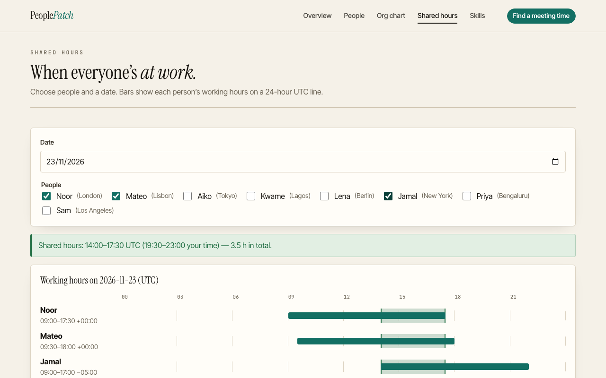
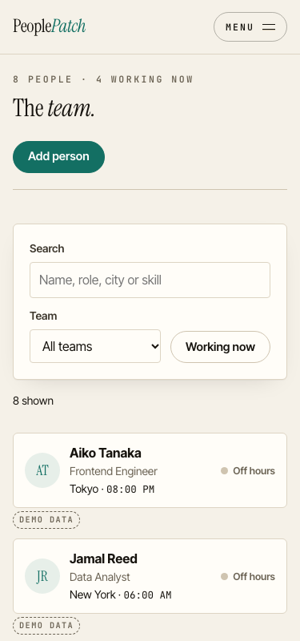

# People Patch

A small-team directory that understands time zones: roles, teams, skills and reporting lines; everyone’s local time and whether they’re working now; an org chart; a skills matrix that flags thin coverage; and a shared-hours finder for scheduling across zones.

**Live demo:** [https://people-patch.vercel.app/](https://people-patch.vercel.app/) — runs entirely in your browser; demo data is fictional and labelled.



| Shared hours | Mobile |
| --- | --- |
|  |  |

## Run it

```bash
npm install
npm run dev        # http://localhost:5217
npm test
npm run build
npm run test:e2e   # Playwright smoke test (npm run e2e:install once if Chromium is missing)
```

## Main workflow

1. The app opens with eight labelled, fictional **teammates** across seven time zones, one on leave and one with a four-day week. **People → Clear demo team** removes them.
2. **People** → cards with local time and status (working now, off hours, away), search by name, role, city or skill, filter by team or “working now”.
3. **Add person** → role, team, city, IANA time zone (defaults to yours), working hours and days, manager, skills with levels (`React:3, SQL:1`) and an optional away period. A manager that would create a reporting loop is refused.
4. **Org chart** → a collapsible tree built from managers; people without a manager are top-level. **Skills** → a person × skill matrix (1 learning, 2 working, 3 expert) and a warning for skills held by one person or with no expert.
5. **Shared hours** → pick people and a date; each person’s working day is drawn on a 24-hour UTC line, with the window everyone shares highlighted and shown in UTC and your own time.

## Rules

- Local times, offsets and daylight saving come from the browser’s time-zone database (`Intl.DateTimeFormat`), so Berlin is UTC+1 in winter and UTC+2 in summer.
- **Working now** = a listed working day, within local hours and not inside an away period. Status refreshes every 30 seconds.
- Shared hours use each person’s offset at noon UTC on the chosen date; people whose day falls on a non-working day are shown hatched.
- Start must be before end; working hours that cross midnight aren’t supported.

## Design

Shared editorial system: Instrument Serif display type, Inter Tight interface text, mono times, status shown with colour plus text, an ink hero whose preview is the real directory cards with live times, and a warm paper workspace. Motion is disabled under `prefers-reduced-motion`.

## Tests

- `src/lib/team.test.ts` — offsets with daylight saving and half-hour zones, zoned date/weekday, availability, UTC overlap across zones, org tree with orphans, loop detection, reporting chain, skills matrix, thin coverage, validation.
- `src/App.test.tsx` — search, org chart, reporting-loop refusal, shared hours on a fixed date, adding a person and skills coverage.
- `e2e/smoke.spec.ts` — with a fixed clock: landing, “working now” filter, edit a profile with reload persistence, org chart, shared hours, skills, plus 375px layout checks.

## Limitations

- No calendar integration; shared hours ignore meetings and holidays.
- Working hours that span midnight (night shifts) aren’t modelled.
- One browser only.

## Future improvements

- Public-holiday calendars per country; a rotating meeting-time suggestion.

## Licence

MIT — see [LICENSE](LICENSE).
